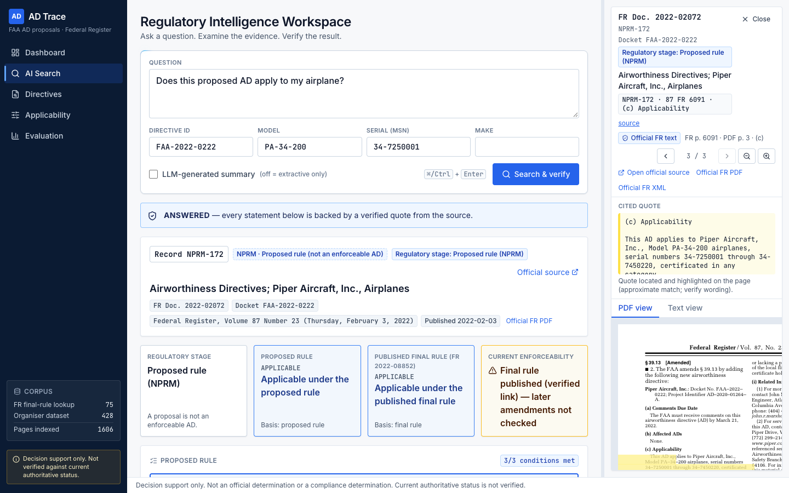

# AD Trace: traceable search over FAA airworthiness directive proposals

Airbus Challenge #4, Autonomous SG 2026.



*Real output from the real corpus, not a mock-up.* Query: "Does this proposed AD apply to my airplane?" with docket FAA-2022-0222, model PA-34-200, serial 34-7250001.
The answer shows the regulatory stage, proposed and final-rule applicability, and enforceability as separate fields. The cited quote is highlighted on the source PDF page.
More screenshots: [applicability checker](docs/screenshots/app_applicability.png) · [directive explorer](docs/screenshots/app_directives.png) · [evaluation dashboard](docs/screenshots/app_evaluation.png) · [landing page](docs/screenshots/landing_full.png) · [mobile](docs/screenshots/mobile_search.png) · [all screenshots](docs/screenshots/).
There is no hosted demo; run it locally with the [quick start](#5-quick-start-macos).

## 1. What it is
A decision-support search engine over the organisers' 431 FAA airworthiness directive (AD) *proposals* (NPRMs and related Federal Register notices).

- Every statement is tied to an exact Federal Register (FR) page and a verbatim quote, which opens in a PDF viewer.
- Applicability and revision status are computed deterministically from the FR text, not by an LLM.
- It refuses (ABSTAINED, or NEEDS_MORE_INFORMATION) instead of guessing.
- **It is not a certified compliance tool.** Most records are proposals, which are not enforceable ADs. See `docs/assumptions_limitations.md`.

## 2. Dataset and corpus
Numbers are from `notes/reconciliation.md` and the evaluation result files.

| Item | Count |
|---|---|
| Organiser records | 431 (an earlier figure of 432 was corrected to 431) |
| FR documents resolved | 428 unique documents, one per resolved record (12 legacy withdrawal rows re-resolved to their withdrawal notice; see `notes/reconciliation.md`) |
| Metadata-only records (no FR document) | 3 |
| Dataset PDF pages | 1,324 |
| Public FR final rules found by an evidence-verified lookup | 75 rules, 272 pages |
| Total indexed pages / chunks | 1,596 pages / 13,513 chunks |

The organiser index workbook (`record_id`, `revision_chains`) is integrated: all 431 `record_id`s are mapped to sheet rows (`positional_verified`), and the 99 chain dockets back the dataset history (`notes/reconciliation.md` §6, `docs/organiser_update_impact.md`).

## 3. Architecture
```
 organiser sheet (431 rows) ---------------------+
 FR XML + govinfo PDF (public, cache-first) -----+--> ingestion + page mapping
                                                       |
                  SQLite + FTS5 (BM25)  <--------------+--> bge-small ONNX embeddings
                          |                                        |
                          +------------- RRF fusion <--------------+
 query --> ID router (docket / FR doc / citation) --> hybrid search
                          |
        +-----------------+--------------------+
        |                 |                    |
 applicability engine  revision evidence   answer selection
 (deterministic,       graph (quoted       (extractive or LLM quote selector)
  3-valued)            evidence per edge)       |
        |                 |               claim verifier V1-V8 (+V9 optional)
        +-----------------+--------------------+
                          |
                FastAPI  -->  Next.js UI with pdf.js viewer
```
- **FR XML/PDF ingestion with page mapping:** parses FR full text into paragraphs, maps each to an FR page and PDF page, with character offsets.
- **SQLite + FTS5:** one deterministic database; BM25 keyword search.
- **bge-small ONNX embeddings:** local dense vectors (`BAAI/bge-small-en-v1.5`, quantized ONNX via fastembed).
- **RRF:** Reciprocal Rank Fusion of BM25 and dense rankings.
- **ID router:** exact lookup of docket IDs, FR document numbers and FR citations before semantic search.
- **Deterministic applicability engine:** parses the (c) Applicability paragraph into a rule; returns APPLICABLE / NOT_APPLICABLE / UNKNOWN / needs-more-information with evidence spans.
- **Revision evidence graph:** withdrawal, supplement, finalisation and proposed-supersession links, each needing quoted evidence.
- **Claim verifier (V1-V8):** deterministic checks that each claim's quote is verbatim and traceable (details in `docs/verification_spec.md`).
- **FastAPI:** the query, applicability, search and evaluation endpoints.
- **Next.js with a pdf.js viewer:** answer cards, citations, source PDF at the cited page.

## 4. Results
Source files: `evaluation/results/20261031-124158_dev.json` (first dev baseline), `20261031-125924_dev.json` (final dev), `20261031-130856_locked.json` (locked). Full tables, breakdowns and failures are in `docs/evaluation_report.md`. All rates are as stored in the result files.

| Metric | Dev baseline | Final dev | Locked | n (baseline / final dev / locked) |
|---|---|---|---|---|
| F1 exact-ID accuracy@1 | 0.9556 | 1.0 | 0.9952 | 1125 / 1125 / 414 |
| F2 doc Recall@5 | 0.8333 | 0.8333 | 0.8056 | 42 / 42 / 36 |
| F2 doc MRR@10 | 0.6955 | 0.6955 | 0.6871 | 42 / 42 / 36 |
| F2 chunk Recall@5 | 0.7143 | 0.7143 | 0.5556 | 42 / 42 / 36 |
| F3 answer accuracy, extractive | 0.25 | 0.3 | 0.2105 | 20 / 20 / 19 |
| F3 answer accuracy, LLM | 0.3 | 0.75 | 0.5789 | 20 / 20 / 19 |
| Citation validity, extractive | 1.0 (36/36) | 1.0 (90/90) | 1.0 (109/109) | citations checked |
| Citation validity, LLM | 1.0 (8/8) | 1.0 (72/72) | 1.0 (79/79) | citations checked |
| F6 revision status accuracy | 1.0 | 1.0 | no cases | 20 / 20 / 0 |
| F6 false-VERIFIED | 0 | 0 | no cases | 20 / 20 / 0 |
| F7 abstention precision | 0.8286 | 0.9375 | 0.92 | 50 / 50 / 43 (refusal + answerable sample) |
| F7 abstention recall | 0.9667 | 1.0 | 0.9583 | 50 / 50 / 43 |
| F7 abstention F1 | 0.8923 | 0.9677 | 0.9388 | 50 / 50 / 43 |
| F8 adversarial pass | 16/16 | 16/16 | 16/16 (dev directives) | 16 / 16 / 16 |
| search() latency p50 / p95 (ms, warm) | 10.65 / 15.55 | 11.23 / 16.64 | 9.35 / 14.85 | 96 / 96 / 84 calls |
| answer(), no LLM, p50 / p95 (ms, warm) | 28.8 / 38.69 | 29.48 / 42.31 | 21.95 / 36.99 | 96 / 96 / 84 calls |

Read these results carefully.
- **Locked run.** It was approved once, with the system frozen at commit `8d46ef3`. It needed 3 evaluator-only crash fixes (see `git log`: `4db3468`, `6b4d4df`, `846b759`). No system code changed.
- **No F6 in locked.** The locked split has no F6 revision cases.
- **F8 uses dev directives.** The locked F8 adversarial scenarios use dev directives. They are not a held-out test.
- **Dev scores are tuned.** Dev F1 = 1.0 followed the router fixes made after the baseline's failures. The F7 dev scores (including recall 1.0) are on data that was also used to calibrate the abstention threshold, so they are optimistic.
- **Generalisation.** The dev to locked drops (F3 LLM 0.75 to 0.5789, F3 extractive 0.3 to 0.2105, F2 chunk Recall@5 0.7143 to 0.5556) are the honest generalisation picture. Eval sets are small (n=19 to 42 for F2/F3/F7).
- **Citation validity.** Citation validity is measured as: the quote equals `doc_text[start:end]` and the FR page lies in the section's page range. It is not a claim that the answers are correct.
- **Fusion ablation (dev, post-hoc).** BM25 alone beats the shipped RRF fusion on dev F2: doc R@5 0.9286 vs 0.8333, MRR@10 0.7832 vs 0.6952 (n=42). The RRF-only misses are exact-identifier questions. The system was left unchanged; see `docs/evaluation_report.md` §10 and `evaluation/ablate_fusion.py`.

## 5. Quick start (macOS)
Needs Python 3.12, Node 20.9+, network access, and Google Chrome for the end-to-end tests. No API key and no login are needed.
```bash
python3.12 -m venv .venv && .venv/bin/pip install -r requirements.txt
.venv/bin/python scripts/fetch_organiser_data.py  # 2 organiser workbooks from the public Drive folder, SHA256-checked
.venv/bin/python scripts/probe_sources.py         # resolve 431 rows to FR documents -> source manifest + FR metadata
.venv/bin/python scripts/fetch_final_rules.py     # public final-rule lookup, frozen at FINAL_RULE_LOOKUP_CUTOFF
.venv/bin/python scripts/ingest.py                # download FR XML + PDFs, build data/indexes/ad.sqlite
.venv/bin/python scripts/build_index.py           # chunks + bge-small embeddings -> search index
bash scripts/run_api.sh                           # API on http://127.0.0.1:8000
cd frontend && npm ci && npm run dev              # UI on http://localhost:3000
```
**Verified from a fresh clone** on 2 Nov 2026 (macOS 15.5, Apple M4) with an empty `data/` folder and no caches. The build had 0 download failures. Every evaluated table came out identical to the evaluated build: document text, pages, sections, relations, final rules and links, organiser index, revision chains, and the search-index chunk fingerprint. `pytest` passed 311 (1 skipped); vitest 36; Playwright 26.
- **Allow about 1.5 hours the first time.** The FR steps make about 2,300 rate-limited requests (about 40 minutes), and embedding 13,574 chunks on CPU takes about 35 minutes. Re-runs are cache-first and take seconds.
- **Keep the machine awake.** A sleeping laptop pauses the build. Wrapping the build in `caffeinate -i` helps, but on battery the Mac still sleeps when the lid closes.
- **Final rules are frozen.** The FR keeps publishing final rules on these dockets; three appeared on 2 Nov 2026. `FINAL_RULE_LOOKUP_CUTOFF = "2026-10-31"` in `backend/config.py` keeps a fresh build identical to the corpus the results were measured on. `fetch_final_rules.py` lists any later rules it skipped.
- Linux should work the same way but was not tested.
UI routes: `/` landing page, `/dashboard`, `/search` (AI search workspace with the source viewer; accepts
`?q=&directive=&model=&serial=&make=` to pre-fill and run), `/directives`, `/applicability`, `/evaluation`.
The API allows CORS from port 3000 only.
Tests and evaluation:
```bash
.venv/bin/pytest tests/ -q
cd frontend && npx vitest run
cd frontend && npm run build && npx playwright test   # end-to-end, real API on :8000 must be running; uses installed Chrome
cd frontend && SCREENSHOTS=1 npx playwright test e2e/screenshots.spec.ts --project=desktop  # refresh docs/screenshots
.venv/bin/python evaluation/evaluate.py --split dev
```
- `ANTHROPIC_API_KEY` is optional. Without it the extractive mode works (no LLM). `scripts/run_api.sh` loads a `.env` file if present.
- The `data/` folders are git-ignored and are rebuilt by the scripts above.
- The locked split is guarded: `evaluation/evaluate.py` refuses it without `--final`, and the locked result is already recorded. Do not re-run it.

## 6. Safety design
- Applicability is never decided by the LLM. If any scope-restricting text is not parsed, the result is UNKNOWN, with the verbatim paragraph shown.
- Proposals and final rules are distinguished on every answer. The text says "proposed", never "in force".
- A revision link needs quoted evidence. A shared docket alone never implies succession. The UI and API state "Current authoritative status NOT verified".
- Every claim must be a verbatim, verified quote. Claims failing the verifier are dropped; if none survive, the system abstains.
- Answers are scoped to a single directive, and other matches are listed as candidates.
- Prompt-injection handling: source text is escaped, injection markers are flagged, and claims whose quote contains injection markers are rejected.
- The verifier checks wording, identifiers, numbers and polarity. It cannot verify full meaning (`notes/verification_report.md`).

## 7. Model usage
- **Runtime:** `claude-sonnet-5-5`, used only as a quote selector for the optional LLM mode. It does not decide applicability or revision status. An extractive no-LLM mode is the fallback.
- **Development:** Claude Code, with Opus for orchestration and review and Sonnet for implementation.

## 8. Documents
- `docs/architecture.md`, `docs/applicability_spec.md`, `docs/verification_spec.md`, `docs/evaluation_spec.md`
- `docs/evaluation_report.md` (full results and failure analysis)
- `docs/assumptions_limitations.md`
- `docs/organiser_update_impact.md` (31 Oct organiser update, change-impact matrix)
- `docs/demo_script.md`
- `notes/*.md` (per-stage reports), `evaluation/README.md`
